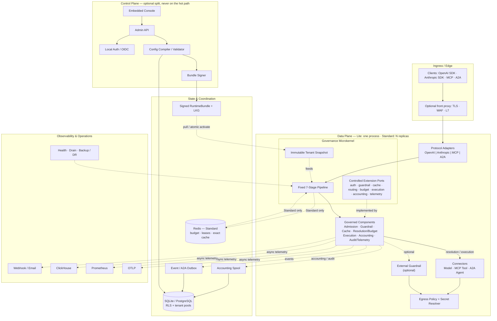
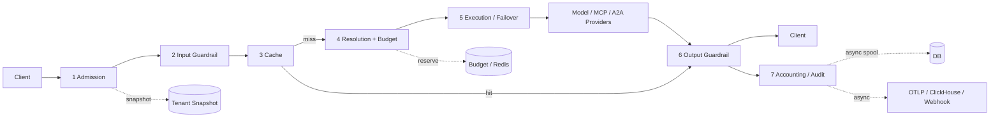

# LiteAIG

**Enterprise AI Governance & Agentic Traffic Control Plane**

English | [简体中文](README.zh-CN.md)

LiteAIG is a modular-monolith, single-binary-first AI gateway. It puts model
calls, tool calls (MCP), and agent-to-agent collaboration (A2A) through one
**fixed seven-stage governance pipeline**, so identity, authorization, cost,
data residency, resilience, and audit semantics apply consistently to every
request. It ships as a self-contained Go binary with an embedded Console and
can grow from a single SQLite process (Lite) to PostgreSQL + Redis multi-replica
deployment (Standard) without changing the data-plane contract.

---

## Contents

- [Why LiteAIG](#why-liteaig)
- [Product capabilities](#product-capabilities)
- [Architecture](#architecture)
- [How LiteAIG compares](#how-liteaig-compares)
- [Quick start](#quick-start)
- [Security model](#security-model)
- [Project layout](#project-layout)
- [Testing and quality gates](#testing-and-quality-gates)
- [Documentation](#documentation)
- [Scope and limitations](#scope-and-limitations)
- [Contributing](#contributing)

## Why LiteAIG

Most AI gateways are excellent proxies. LiteAIG is designed as a **governance
control plane** first:

- **Governance is structural, not a plugin side effect.** All traffic is
  normalized into a canonical interaction model and passes the same pipeline.
  New capabilities attach as checkpoints; they cannot bypass admission,
  accounting, or audit.
- **Agentic traffic is a first-class citizen.** MCP tools/tasks and A2A
  agents are governed with the same keys, budgets, policies, approvals, and
  evidence as model calls.
- **Cost is part of correctness.** Budget reservations, RPM/TPM, token
  accounting, cache savings, and provider-cost attribution are built into the
  request path.
- **Operationally simple.** One static binary, an embedded Console, SQLite or
  PostgreSQL, and optional Redis coordination. No Python runtime, no separate
  UI service, no mandatory Kubernetes dependency.
- **Safe configuration delivery.** Tenant configuration is compiled into
  immutable runtime snapshots, signed into RuntimeBundles, activated
  atomically, and protected by a last-known-good fallback.

### At a glance

| | Lite | Standard |
|---|---|---|
| Store | SQLite, single writer | PostgreSQL |
| Coordination | In-process | PostgreSQL leases + Redis ledger/leases |
| Topology | One `mode=all` process | Split `gateway` / `control` replicas |
| Best for | Edge, lab, small teams, single tenant | Production HA, multi-tenant |
| Binary | One static Go binary with embedded Console | Same binary |
| Reference build | ~35 MB stripped binary; ~25 MB idle RSS | Horizontal scaling with external stores |

> Resource numbers are reference measurements from a local build, not a
> capacity guarantee. Benchmark your own topology and model mix.

---

## Product capabilities

### 1. Unified AI access

- Providers: OpenAI, Anthropic, Azure OpenAI, AWS Bedrock, Google Vertex AI,
  Gemini native, and OpenAI-compatible endpoints.
- Protocols: OpenAI Chat Completions, Responses, Embeddings, Rerank, Audio
  transcription/translation/speech, Files, Batch; Anthropic Messages; MCP
  JSON-RPC; A2A 0.3/1.0.
- Streaming SSE, tool/function calling, structured output, vision content
  parts, and multimodal request normalization.
- Logical models decouple application aliases from concrete deployments, so
  routing and provider changes do not require client changes.

### 2. Fixed seven-stage governance pipeline

Every model, MCP, and A2A request goes through:

1. **Admission** — authentication, virtual keys, rate/concurrency limits,
   request-size limits.
2. **Input Guardrail** — keyword/regex/secret/PII/prompt-injection rules,
   context guard, optional external content-safety service.
3. **Cache** — exact cache and semantic cache; a hit short-circuits execution
   but still records accounting and telemetry.
4. **Resolution** — model/tool/agent routing, data-residency constraints,
   budget reservation, capability checks.
5. **Execution Resilience** — retries, fallback, circuit breaking, credential
   pools, configurable stream/provider timeouts.
6. **OutputStream Guardrail** — inline/buffered/shadow streaming guard and
   optional LLM-as-Judge / groundedness checks.
7. **Accounting & Telemetry** — token metering, cost attribution, audit
   events, metrics, traces, and durable spooling.

### 3. Cost and FinOps

- Tenant → Project → Key budgets with distributed reservations in Standard
  tier.
- RPM/TPM limits, per-key quotas, concurrency leases, and in-flight tracking.
- Input/output/cache/reasoning/tool token accounting with provider usage
  reconciliation.
- Cache hit rate, avoided tokens, reference-price cost estimates, and
  unpriced-token reporting.
- Auxiliary embedding/judge calls are budgeted and recorded with a
  `parent_request_id` instead of disappearing outside FinOps.

### 4. Agentic governance

- **MCP**: tool catalog, per-tool policies, approvals, rate/budget limits,
  tool-call ledger, `tools/call` and `tasks/*` governance.
- **A2A**: agent endpoints, capability routing, trust relationships,
  delegation hops, federated identity, task idempotency, and exactly-once
  push outbox.
- Human approval and separation-of-duties workflows.
- Agent/task graph derived from the accounting ledger for audit and
  optimization.

### 5. Operations and security

- Embedded web Console: setup wizard, providers, models, keys, projects,
  policies, guardrails, cache, FinOps, alerts, audit, and agent views.
- Local Argon2id admins + OIDC SSO, CSRF protection, and role-based access.
- PostgreSQL RLS with tenant-scoped connection pools and `app.tenant_id`.
- Encrypted secrets, master-key sidecar for SQLite, and unified egress/SSRF
  policy for provider and guardrail calls.
- Signed RuntimeBundles, atomic activation, NACK keeps last-known-good.
- OTLP traces/metrics/logs, Prometheus `/metrics`, ClickHouse analytics sink,
  webhook/email alerts, and evidence export.
- Graceful drain, backup/restore scripts, DR drill CLI, and Kubernetes Helm
  chart with HPA/PDB.

### 6. Developer experience

- OpenAI-compatible API; existing SDKs work after changing the base URL and
  key.
- Official Go, JavaScript/TypeScript, and Python SDKs.
- OpenAPI contract, API-version headers, and compatibility gates in CI.
- One-command local startup and a built-in mock-provider test harness.

---

## Architecture

LiteAIG is a **fixed-pipeline microkernel**, not a linear proxy chain. A small
kernel owns the canonical interaction model, the seven-stage pipeline,
immutable tenant snapshots, and controlled extension ports. Protocol adapters,
governance components, connectors, stores, and the control plane attach around
it. **Lite is a deployment profile, not a different architecture.**

### Design principles

| Principle | How LiteAIG applies it |
|---|---|
| **Microkernel** | Kernel depends only on contracts: canonical interaction, pipeline engine, runtime snapshot, extension ports. Concrete providers, stores, and UI live outside. Enforced by `architecture/forbidden-imports.yaml`. |
| **Componentization** | Admission, guardrail, cache, resolution/budget, execution, accounting, and telemetry are separate governed components with narrow interfaces. Connectors never own policy. |
| **Lightweight & agile** | Lite is one process with SQLite and in-memory state. Standard adds PostgreSQL + Redis and optional split planes. No mandatory Kubernetes, Envoy, or Python runtime. |
| **High performance** | The hot path uses in-memory snapshots, exact/semantic cache, and Redis for cross-replica budgets/leases and shared exact cache. Usage, audit, and telemetry leave the hot path through spool/outbox. |
| **Secure & reliable** | Explicit ingress, admin, tenant, egress, and supply-chain boundaries; RLS; secret resolver; signed RuntimeBundle; last-known-good; circuit breaking; graceful drain. |

### Logical architecture



Solid edges are synchronous request/control paths; dotted edges are asynchronous
or deployment-specific. The diagram is intentionally a logical view: Lite runs
the same components in one process.

**Kernel vs components vs adapters**

| Layer | Owns | Must not own |
|---|---|---|
| **Kernel** | Canonical interaction, fixed stage order, snapshot semantics, extension contracts | Provider SDKs, SQL, UI, vendor-specific policy |
| **Governed components** | One policy domain each: admission, guardrail, cache, routing/budget, execution, accounting, telemetry | Cross-domain side effects or direct provider calls |
| **Adapters / connectors** | Wire protocols and upstream translation | Auth, budget, audit, or other governance decisions |
| **Control plane** | Config compile/validate/publish, signing, Admin API, Console, identity | Request-path execution |
| **State** | Durable config, ledger, audit, budgets, leases, bundles, spool/outbox | Business policy embedded in storage |

### Request lifecycle



The solid path is the synchronous request path. The dotted path is durable but
asynchronous: a cache hit still passes the output guardrail and accounting
stage, and accounting/telemetry never block the provider stream.

### Deployment profiles

| Aspect | Lite | Standard |
|---|---|---|
| Process topology | One `mode=all` process | Split `gateway` / `control` replicas |
| Configuration | SQLite + master-key sidecar | PostgreSQL + signed RuntimeBundle |
| Coordination | In-process | PostgreSQL leases + Redis ledger/leases |
| Cache | In-process exact + bounded semantic | Redis exact cache + in-process semantic |
| Failure behavior | Restart and recover from local state | Control-plane outage keeps LKG; replica loss handled by HPA/PDB |
| Operations | Minimal single binary | HPA/PDB, drain, multi-replica, external stores |

### Security and reliability boundaries

| Boundary | Controls |
|---|---|
| **Ingress** | Virtual API keys, body limits, optional TLS/WAF/L7 front proxy |
| **Admin** | Separate listener, local Argon2id or OIDC, CSRF, RBAC |
| **Tenant** | Immutable runtime snapshot, tenant context, PostgreSQL RLS + scoped pools |
| **Egress** | Unified allowlist/SSRF policy, secret resolver, external guardrail isolation |
| **Supply chain** | Signed RuntimeBundle, LKG fallback, non-root distroless image, SBOM in release |
| **Audit** | Redacted domain events, evidence export, durable spool/outbox, OTLP logs |

The data plane can keep serving from the last-known-good snapshot when the
control plane is unavailable. Budget and lease state is coordinated through
Redis in Standard; the Lite tier does not require Redis.

---

## How LiteAIG compares

> This table is a positioning aid, not a benchmark. These projects evolve
> quickly; verify current capabilities against their official documentation.

| Dimension | **LiteAIG** | **LiteLLM** | **Higress** | **Kong AI Gateway** |
|---|---|---|---|---|
| Primary positioning | AI governance & agentic traffic control plane | LLM proxy/SDK + MCP/Agent gateway | Cloud-native API gateway with AI/MCP/Agent plugins | Enterprise AI Gateway with AI entities and policies |
| Runtime | Go, single static binary | Python service/SDK | Envoy/Istio, Kubernetes-native or standalone Docker | Nginx/OpenResty, Kong Gateway CP/DP |
| Configuration | Compile-time validated snapshots + signed bundles | YAML + Python callbacks/hooks | Kubernetes CRDs/Gateway API + Wasm | Kong entities + AI policies/plugins, decK/kongctl/Terraform |
| Extensibility | Fixed pipeline + controlled checkpoints; compile-time registries and external guardrail hooks | Python ecosystem and callbacks | Wasm plugin ecosystem, CRDs | Large plugin ecosystem; Lua/Go/Python/JS |
| Provider breadth | OpenAI, Anthropic, Azure, Bedrock, Vertex, Gemini, compatible endpoints | Very broad multi-provider catalog | Broad AI provider support via AI plugins | Broad AI provider support via AI plugins |
| Governance model | Fixed seven stages, budgets, TPM/RPM, RLS, audit, evidence | Virtual keys, budgets, rate limits, routing, caching, guardrails, async spend logging | L7/WAF, AI token limits, cache, content safety, quota | AI rate limiting, prompt/semantic guard, PII, semantic cache, cost management |
| Agentic / MCP | A2A 0.3/1.0 + MCP tools/tasks, same governance path, approvals, federation/trust | MCP Gateway + Agent Gateway (A2A); router-centric | MCP Server + AI Agent; plugin-centric | AI MCP Server + A2A traffic + AI policies |
| Deployment | Binary, Docker, Helm; SQLite or PostgreSQL + Redis | Python service with DB/Redis | Kubernetes or Docker | Konnect or self-hosted Kong CP/DP |
| Sweet spot | Regulated AI governance, A2A/MCP control, FinOps, small footprint | Fastest path to many providers in Python | Platform teams on Envoy/Istio needing L7 + AI | Enterprises standardized on Kong |

**Trade-offs at a glance**

- **LiteAIG**: smaller provider catalog and plugin ecosystem than the
  incumbents; not a general L7/WAF gateway. Best when governance semantics and
  a small operational footprint dominate.
- **LiteLLM**: very broad provider catalog and a mature Python ecosystem; its
  governance model is proxy/router-centric rather than a fixed governance
  pipeline.
- **Higress**: excellent Kubernetes/Envoy integration and Wasm plugin reach;
  requires a cloud-native data plane and Kubernetes operating model.
- **Kong AI Gateway**: mature enterprise gateway, AI entities, and a large
  plugin ecosystem; brings the Kong platform, CP/DP operations, and licensing
  considerations.

**Choose LiteAIG when** governance, cost attribution, auditability, A2A/MCP
trust, and a small operational footprint matter more than having the largest
provider catalog or a general-purpose L7 plugin ecosystem.

**LiteAIG is not a replacement for a general API gateway.** It is designed to
work as an AI governance layer, optionally behind Kong, Higress, Envoy, or a
cloud load balancer.

---

## Quick start

### Prerequisites

- Go 1.25+
- Node.js 22+ (the Console assets are embedded into the Go binary and are not
  tracked, so a fresh source checkout must build them first; the Docker build
  does this automatically)
- Docker and Helm are optional

### Run from source (Lite)

```bash
git clone https://github.com/F31/liteAIG.git
cd liteAIG

# Build the embedded Console assets once (fresh clone)
(cd web/console && npm ci && npm run build)

go build -o liteaig ./cmd/liteaig

export LITEAIG_MASTER_KEY="$(openssl rand -base64 32)"
./liteaig \
  --db file:./liteaig.db \
  --admin-addr 127.0.0.1:8081 \
  --gateway-addr 127.0.0.1:8082
```

Open `http://127.0.0.1:8081` and complete the setup wizard. The wizard creates
the first tenant, provider, logical model, and virtual key.

```bash
export LITEAIG_KEY="<virtual-key-from-setup>"

curl -s http://127.0.0.1:8082/v1/chat/completions \
  -H "Authorization: Bearer $LITEAIG_KEY" \
  -H "Content-Type: application/json" \
  -d '{
    "model": "default-chat",
    "messages": [{"role": "user", "content": "Hello from LiteAIG"}]
  }'
```

Streaming:

```bash
curl -N http://127.0.0.1:8082/v1/chat/completions \
  -H "Authorization: Bearer $LITEAIG_KEY" \
  -H "Content-Type: application/json" \
  -d '{
    "model": "default-chat",
    "stream": true,
    "messages": [{"role": "user", "content": "Count to five"}]
  }'
```

### Docker

```bash
docker build -t liteaig .

docker run --rm \
  -p 8081:8081 -p 8082:8082 \
  -v liteaig-data:/data \
  -e LITEAIG_MASTER_KEY="$(openssl rand -base64 32)" \
  liteaig \
  --db file:/data/liteaig.db \
  --admin-addr 0.0.0.0:8081 \
  --gateway-addr 0.0.0.0:8082
```

The image runs as distroless non-root (`65532`). For production, terminate
TLS at a reverse proxy or ingress and restrict the Admin API to trusted
networks.

### Kubernetes / Standard tier

The Helm chart supports split `gateway` and `control` planes, HPA, PDB,
rolling updates, and drain settings. The Standard tier requires PostgreSQL and
Redis.

```bash
helm install liteaig ./deploy/helm/liteaig \
  -f ./deploy/helm/liteaig/examples/split-plane-values.yaml
```

Create the referenced Secret (`liteaig-standard`) with `database_dsn`,
`coordinator_url`, `liteaig_master_key`, `bundle_token`,
`bundle_signing_key`, and `bundle_public_key` before installing. See the
chart comments and [Deployment](docs/DEPLOYMENT.md) for production details.

### Configuration highlights

| Flag / env | Purpose |
|---|---|
| `--db` | SQLite DSN (Lite) or PostgreSQL DSN (Standard) |
| `--mode=all\|gateway\|control` | Single process or split planes |
| `--coordinator` | Redis URL for Standard-tier ledger/leases |
| `--postgres-rls` | Enable PostgreSQL RLS and tenant-scoped pools (default true) |
| `--postgres-tenant-pools` | Max lazy tenant pools (default 16, 2 connections each) |
| `--gateway-rpm`, `--gateway-tpm` | Request/token limits |
| `--gateway-max-body-bytes` | Raise for audio/vision/files |
| `--stream-total-timeout` | `0` = no overall stream deadline |
| `--stream-idle-timeout`, `--first-token-timeout`, `--provider-timeout` | AI traffic tuning |
| `--external-guardrail-url` | Layer 3 external content-safety service |
| `LITEAIG_MASTER_KEY` | Master key for secret encryption (required for PostgreSQL) |
| `--otlp-*` | OTLP traces/metrics/logs export |

---

## Security model

- Data-plane requests use virtual API keys; tenant snapshots are recompiled
  on key changes.
- Control plane supports local Argon2id admins and OIDC SSO with CSRF
  protection and RBAC.
- PostgreSQL RLS is enabled by default for tenant-scoped tables. Tenant
  requests use restricted `liteaig_app` pools with `app.tenant_id`; control
  plane/background tasks use the trusted platform pool.
- Secrets are encrypted at rest; provider and guardrail calls share a unified
  egress/SSRF policy.
- RuntimeBundles are signed and activated atomically; a bad bundle is rejected
  and the last-known-good snapshot keeps serving.
- Audit events, evidence export, structured security events, and OTLP logs are
  designed to avoid request bodies and secrets.

See [Security architecture](docs/WHITEPAPER.md) for details and operational
caveats.

---

## Project layout

```text
cmd/liteaig/                 single-binary entry point
internal/access/protocol/    OpenAI / Anthropic / MCP / A2A adapters
internal/gateway/            admission, guardrails, cache, routing, execution
internal/connectors/         model, tool, and agent connectors
internal/controlplane/       config lifecycle, Admin API, Console backend
internal/finops/             budgets, accounting, pricing, chargeback
internal/federation/         A2A trust, delegation, push outbox
internal/platform/           storage, coordination, crypto, egress, telemetry
internal/kernel/             interaction model, pipeline contracts, snapshots
web/console/                 embedded React Console
deploy/helm/liteaig/         Kubernetes chart
migrations/                  SQLite/PostgreSQL schema
```

---

## Testing and quality gates

```bash
make test      # go test -race ./...
make check     # go vet + architecture boundaries + console checks
go build ./...
```

Notable gates:

- Architecture boundary test (`cmd/architecture-test`)
- Gateway load smoke (`internal/app/gateway_load_smoke_test.go`)
- PostgreSQL RLS integration and end-to-end tests
- Official SDK conformance and OpenAPI compatibility checks
- Kubernetes kind Standard-tier smoke (Postgres + Redis + multi-replica)
- `govulncheck`, npm audit, Helm/Kubernetes manifest validation in CI

PostgreSQL-backed tests use `LITEAIG_TEST_POSTGRES_DSN`; Redis-backed tests
use the repository's coordination test environment.

---

## Documentation

- [Whitepaper: product and architecture](docs/WHITEPAPER.md)
- [Deployment guide](docs/DEPLOYMENT.md)
- [Gap analysis and roadmap](docs/GAP_ANALYSIS.md)
- [DR runbook](docs/DR_RUNBOOK.md)
- [API compatibility](docs/API_COMPATIBILITY.md)
- [SDK compatibility](docs/SDK_COMPATIBILITY.md)
- [A2A conformance](docs/A2A_CONFORMANCE.md)
- [Gateway benchmark](docs/GATEWAY_BENCHMARK.md)

---

## Scope and limitations

LiteAIG intentionally focuses on AI and agentic governance. It is **not** an
Agent runtime, RAG platform, Prompt IDE, model trainer, or general-purpose L7
gateway. Its extension model is controlled and compile-time-first; it does not
aim to replace Kong/Higress plugin ecosystems.

Current boundaries:

- Lite tier uses SQLite and is single-writer; use Standard for replicated
  production topologies.
- Semantic cache is bounded in-process by default; Standard exact cache and
  RPM/TPM use Redis, while a distributed vector index is still on the roadmap.
- Full multi-tenant SaaS, multi-AZ active traffic switching, SAML/SCIM, MCP
  task storage, and broader plugin bridges remain roadmap items. See
  [Gap analysis](docs/GAP_ANALYSIS.md) for the live list.

---

## Contributing

Issues and pull requests are welcome. Before submitting:

```bash
make test
make check
```

Keep the fixed pipeline invariant: new capabilities must attach as checkpoints
inside existing stages, and tenant-scoped data access must carry a
`TenantScope`/tenant context.
