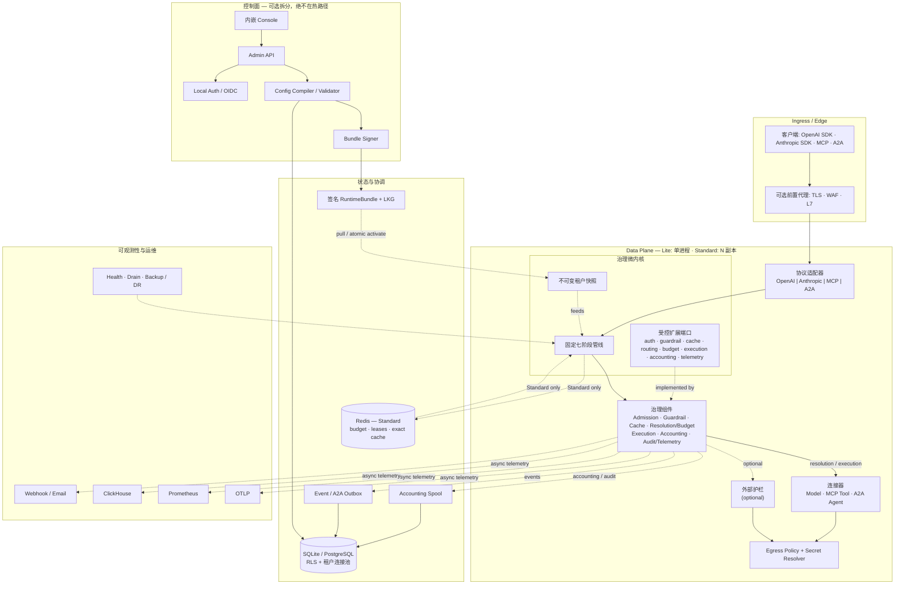
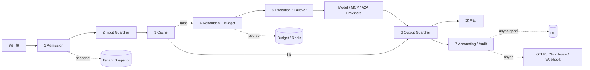

# LiteAIG

**企业级 AI Governance 与 Agentic Traffic Control Plane**

[English](README.md) | 简体中文

LiteAIG 是一个模块化单体、单二进制优先的 AI 网关。它把模型调用、工具调用（MCP）与 Agent 协作（A2A）统一收敛到一条**固定七阶段治理管线**，使身份、授权、成本、数据边界、故障与审计语义对所有流量一致生效。它以一个自包含 Go 二进制交付，内嵌 Console，并可从单机 SQLite（Lite）平滑演进到 PostgreSQL + Redis 多副本（Standard），而数据面契约不变。

---

## 目录

- [为什么选择 LiteAIG](#为什么选择-liteaig)
- [产品功能特性](#产品功能特性)
- [技术架构](#技术架构)
- [与 LiteLLM、Higress、Kong AI Gateway 的对比](#与-litellmhigresskong-ai-gateway-的对比)
- [快速开始](#快速开始)
- [安全模型](#安全模型)
- [项目结构](#项目结构)
- [测试与质量门禁](#测试与质量门禁)
- [文档](#文档)
- [范围与限制](#范围与限制)
- [贡献](#贡献)

## 为什么选择 LiteAIG

大多数 AI 网关首先是一个优秀的代理。LiteAIG 首先是一个**治理控制平面**：

- **治理是结构性的，而不是插件副作用。** 所有流量统一归一化为 canonical interaction，并经过同一条管线。新能力只能挂接为检查点，不能绕过准入、记账或审计。
- **Agentic 流量是一等公民。** MCP 工具/任务与 A2A Agent 和模型调用共享同一套密钥、预算、策略、审批与证据链。
- **成本是正确性的一部分。** 预算预留、RPM/TPM、Token 计量、缓存节省与 Provider 成本归因都内建在请求路径中。
- **运维足够简单。** 一个静态二进制、内嵌 Console、SQLite 或 PostgreSQL、可选 Redis 协调；无 Python 运行时、无独立 UI 服务、不强制依赖 Kubernetes。
- **配置交付安全可回滚。** 租户配置编译为不可变运行时快照，签名为 RuntimeBundle，原子激活，并由 last-known-good 兜底。

### 一眼看懂

| | Lite | Standard |
|---|---|---|
| 存储 | SQLite，单写者 | PostgreSQL |
| 协调 | 进程内 | PostgreSQL 租约 + Redis 账本/租约 |
| 拓扑 | 单个 `mode=all` 进程 | `gateway` / `control` 分离副本 |
| 适用 | 边缘、实验室、小团队、单租户 | 生产高可用、多租户 |
| 二进制 | 一个静态 Go 二进制，内嵌 Console | 同一二进制 |
| 参考构建 | 约 35 MB stripped 二进制；空闲 RSS 约 25 MB | 通过外部存储水平扩展 |

> 资源数字来自本地参考构建，不构成容量承诺。请按自己的拓扑与模型组合压测。

---

## 产品功能特性

### 1. 统一 AI 接入

- Provider：OpenAI、Anthropic、Azure OpenAI、AWS Bedrock、Google Vertex AI、Gemini 原生，以及 OpenAI-Compatible 端点。
- 协议：OpenAI Chat Completions、Responses、Embeddings、Rerank、Audio transcription/translation/speech、Files、Batch；Anthropic Messages；MCP JSON-RPC；A2A 0.3/1.0。
- 支持 SSE 流式、Tool/Function Calling、结构化输出、Vision content parts 与多模态请求归一化。
- Logical Model 将应用别名与具体 Deployment 解耦，切换 Provider 或路由策略无需修改客户端。

### 2. 固定七阶段治理管线

所有模型、MCP、A2A 请求都经过：

1. **Admission（准入）**：认证、虚拟密钥、速率/并发限制、请求体上限。
2. **Input Guardrail（输入护栏）**：关键词/正则/Secret/PII/Prompt Injection 规则、上下文守卫、可选外部内容安全服务。
3. **Cache（缓存）**：精确缓存 + 语义缓存；命中即短路执行，但仍完整记账与上报遥测。
4. **Resolution（解析）**：模型/工具/Agent 路由、数据地域约束、预算预留、能力校验。
5. **Execution Resilience（执行韧性）**：重试、回退、熔断、凭据池、可配置的流式/Provider 超时。
6. **OutputStream Guardrail（输出护栏）**：Inline/Buffered/Shadow 流式三级护栏，可选 LLM-as-Judge 与 Groundedness 检查。
7. **Accounting & Telemetry（记账与遥测）**：Token 计量、成本归因、审计事件、指标、追踪与持久化 Spool。

### 3. 成本与 FinOps

- Tenant → Project → Key 多级预算；Standard 档支持分布式预算预留。
- RPM/TPM、Key 配额、并发租约与在途请求跟踪。
- Input/Output/Cache/Reasoning/Tool Token 计量，并与 Provider usage 对账。
- 缓存命中率、规避 Token、参考价成本估算与未定价 Token 报告。
- 语义缓存 embedding 与 LLM-as-Judge 等辅助调用也进入预算并写入带 `parent_request_id` 的辅助 usage 记录，不再游离于 FinOps 之外。

### 4. Agentic 治理

- **MCP**：工具目录、按工具策略、审批、速率/预算限制、工具调用账本、`tools/call` 与 `tasks/*` 治理。
- **A2A**：Agent Endpoint、能力路由、信任关系、委托跳数、联邦身份、任务幂等与 exactly-once Push Outbox。
- 人工审批与职责分离（SoD）工作流。
- 从记账账本派生 Agent/Task Graph，用于审计与优化分析。

### 5. 运维与安全

- 内嵌 Web Console：Setup Wizard、Provider、模型、密钥、项目、策略、护栏、缓存、FinOps、告警、审计与 Agent 视图。
- 本地 Argon2id 管理员 + OIDC SSO、CSRF 防护与 RBAC。
- PostgreSQL RLS：租户级连接池与 `app.tenant_id`。
- 密钥加密落库；SQLite Master Key Sidecar；Provider 与外部护栏统一 egress/SSRF 策略。
- RuntimeBundle 签名、原子激活；签名或校验失败时保留 last-known-good。
- OTLP Traces/Metrics/Logs、Prometheus `/metrics`、ClickHouse Analytics Sink、Webhook/邮件告警与 Evidence Export。
- 优雅 Drain、备份恢复脚本、DR Drill CLI，以及支持 HPA/PDB 的 Kubernetes Helm Chart。

### 6. 开发者体验

- OpenAI-Compatible API：现有 SDK 只需修改 Base URL 与 Key。
- 官方 Go、JavaScript/TypeScript、Python SDK。
- OpenAPI 契约、API Version Header 与 CI 兼容性门禁。
- 一条命令本地启动，内置 mock-provider 测试设施。

---

## 技术架构

LiteAIG 是一个**固定管线微内核**，不是线性代理链。微内核只负责 Canonical Interaction、七阶段管线、不可变租户快照与受控扩展端口；协议适配器、治理组件、连接器、状态存储与控制面围绕它组合。**Lite 是部署形态，不是另一套架构。**

### 设计原则

| 原则 | LiteAIG 的落地方式 |
|---|---|
| **微内核** | Kernel 只依赖 contracts：Canonical Interaction、Pipeline Engine、Runtime Snapshot、Extension Ports。具体 Provider、存储与 UI 都在核外。由 `architecture/forbidden-imports.yaml` 强制。 |
| **组件化** | Admission、Guardrail、Cache、Resolution/Budget、Execution、Accounting、Telemetry 是独立治理组件，接口窄、边界清晰。Connector 不承载策略。 |
| **轻量敏捷** | Lite 是单进程 + SQLite + 内存状态；Standard 增加 PostgreSQL + Redis 与可选分离平面。不强制 Kubernetes、Envoy 或 Python 运行时。 |
| **性能高效** | 热路径使用内存快照、精确/语义缓存；Redis 用于跨副本预算/租约与共享精确缓存。Usage、Audit、Telemetry 通过 Spool/Outbox 离开热路径。 |
| **安全可靠** | 显式划分 Ingress、Admin、Tenant、Egress、Supply Chain 边界；RLS、Secret Resolver、签名 RuntimeBundle、LKG、熔断与优雅 Drain。 |

### 逻辑架构



实线表示同步请求/控制路径，虚线表示异步或特定部署形态。该图是逻辑视图：
Lite 在同一进程中运行相同的组件。

**微内核 vs 组件 vs 适配器**

| 层 | 负责 | 不应负责 |
|---|---|---|
| **Kernel** | Canonical Interaction、固定阶段顺序、快照语义、扩展契约 | Provider SDK、SQL、UI、厂商特定策略 |
| **治理组件** | 各自单一策略域：准入、护栏、缓存、路由/预算、执行、记账、遥测 | 跨域副作用或直接调用 Provider |
| **适配器 / 连接器** | 线协议与上游翻译 | 认证、预算、审计等治理决策 |
| **控制面** | 配置编译/校验/发布、签名、Admin API、Console、身份 | 请求路径执行 |
| **状态** | 持久配置、账本、审计、预算、租约、Bundle、Spool/Outbox | 把业务策略埋进存储 |

### 请求生命周期



实线是同步请求路径，虚线是持久化但异步的尾路径：缓存命中仍需经过输出护栏与记账阶段；记账/遥测不会阻塞 Provider 流式响应。

### 部署剖面

| 维度 | Lite | Standard |
|---|---|---|
| 进程拓扑 | 单个 `mode=all` 进程 | `gateway` / `control` 分离副本 |
| 配置 | SQLite + Master Key Sidecar | PostgreSQL + 签名 RuntimeBundle |
| 协调 | 进程内 | PostgreSQL 租约 + Redis 账本/租约 |
| 缓存 | 进程内精确缓存 + 有界语义缓存 | Redis 精确缓存 + 进程内语义缓存 |
| 故障行为 | 重启并从本地状态恢复 | 控制面故障保留 LKG；副本故障由 HPA/PDB 处理 |
| 运维 | 极简单二进制 | HPA/PDB、Drain、多副本、外部存储 |

### 安全与可靠性边界

| 边界 | 控制 |
|---|---|
| **Ingress** | Virtual API Key、请求体上限、可选 TLS/WAF/L7 前置代理 |
| **Admin** | 独立监听、本地 Argon2id 或 OIDC、CSRF、RBAC |
| **Tenant** | 不可变运行时快照、tenant context、PostgreSQL RLS + 租户连接池 |
| **Egress** | 统一 allowlist/SSRF 策略、Secret Resolver、外部护栏隔离 |
| **Supply Chain** | 签名 RuntimeBundle、LKG 兜底、非 root distroless 镜像、发布 SBOM |
| **Audit** | 脱敏 Domain Event、Evidence Export、持久 Spool/Outbox、OTLP 日志 |

控制面不可用时，数据面可继续使用 last-known-good 快照服务。Standard 档通过 Redis 协调预算与租约；Lite 档不依赖 Redis。

---

## 与 LiteLLM、Higress、Kong AI Gateway 的对比

> 下表用于产品定位参考，不是性能基准。各项目迭代很快，请以官方文档为准。

| 维度 | **LiteAIG** | **LiteLLM** | **Higress** | **Kong AI Gateway** |
|---|---|---|---|---|
| 核心定位 | AI 治理与 Agentic Traffic Control Plane | LLM Proxy/SDK + MCP/Agent Gateway | 云原生 API Gateway + AI/MCP/Agent 插件 | 企业级 AI Gateway + AI 实体与策略 |
| 运行时 | Go，单静态二进制 | Python 服务/SDK | Envoy/Istio，Kubernetes 原生或独立 Docker | Nginx/OpenResty，Kong Gateway CP/DP |
| 配置模型 | 编译期校验快照 + 签名 Bundle | YAML + Python callback/hook | Kubernetes CRD/Gateway API + Wasm | Kong Entity + AI Policy/Plugin，decK/kongctl/Terraform |
| 扩展机制 | 固定管线 + 受控检查点；编译期注册与受控外部护栏 Hook | Python 生态与 callback | Wasm 插件生态、CRD | 大型插件生态；Lua/Go/Python/JS |
| Provider 覆盖 | OpenAI、Anthropic、Azure、Bedrock、Vertex、Gemini、Compatible | 非常广泛的多 Provider 目录 | 通过 AI 插件支持广泛 Provider | 通过 AI 插件支持广泛 Provider |
| 治理模型 | 固定七阶段、预算、TPM/RPM、RLS、审计、证据 | Virtual Key、预算、限流、路由、缓存、护栏、异步 Spend Logging | L7/WAF、AI Token 限制、缓存、内容安全、配额 | AI 限流、Prompt/Semantic Guard、PII、Semantic Cache、成本管理 |
| Agentic / MCP | A2A 0.3/1.0 + MCP Tools/Tasks，同一治理路径，审批、联邦/信任 | MCP Gateway + Agent Gateway（A2A）；Router 中心 | MCP Server + AI Agent；插件中心 | AI MCP Server + A2A 流量 + AI Policy |
| 部署 | Binary、Docker、Helm；SQLite 或 PostgreSQL + Redis | Python 服务 + DB/Redis | Kubernetes 或 Docker | Konnect 或自托管 Kong CP/DP |
| 最适合 | 强治理、A2A/MCP 控制、FinOps、轻量运维 | 在 Python 生态中快速接入大量 Provider | 已使用 Envoy/Istio、需要 L7 + AI 的平台团队 | 已标准化在 Kong 上的企业 |

**取舍一览**

- **LiteAIG**：Provider 目录与插件生态小于成熟网关，且不是通用 L7/WAF 网关；当治理语义与轻量运维优先时最合适。
- **LiteLLM**：Provider 目录与 Python 生态非常成熟；治理模型更偏 Proxy/Router 中心，而不是固定治理管线。
- **Higress**：Kubernetes/Envoy 集成与 Wasm 插件覆盖出色；需要云原生数据面与 K8s 运维模型。
- **Kong AI Gateway**：成熟的企业网关、AI 实体与大型插件生态；需要 Kong 平台、CP/DP 运维，并考虑许可成本。

**选择 LiteAIG 的典型场景**：治理、成本归因、审计、A2A/MCP 信任与较小运维足迹，比“最大 Provider 目录”或“通用 L7 插件生态”更重要。

**LiteAIG 不替代通用 API Gateway。** 它更适合作为 AI 治理层，部署在 Kong、Higress、Envoy 或云负载均衡之后。

---

## 快速开始

### 前置条件

- Go 1.25+
- Node.js 22+：Console 资源会嵌入 Go 二进制且不纳入 Git 跟踪，因此全新
  源码检出必须先构建 Console；Docker 构建会自动完成
- Docker 与 Helm 可选

### 从源码运行（Lite）

```bash
git clone https://github.com/F31/liteAIG.git
cd liteAIG

# 全新检出先构建一次内嵌 Console 资源
(cd web/console && npm ci && npm run build)

go build -o liteaig ./cmd/liteaig

export LITEAIG_MASTER_KEY="$(openssl rand -base64 32)"
./liteaig \
  --db file:./liteaig.db \
  --admin-addr 127.0.0.1:8081 \
  --gateway-addr 127.0.0.1:8082
```

打开 `http://127.0.0.1:8081`，完成 Setup Wizard。向导会创建首个 Tenant、Provider、Logical Model 与 Virtual Key。

```bash
export LITEAIG_KEY="<setup 生成的 virtual key>"

curl -s http://127.0.0.1:8082/v1/chat/completions \
  -H "Authorization: Bearer $LITEAIG_KEY" \
  -H "Content-Type: application/json" \
  -d '{
    "model": "default-chat",
    "messages": [{"role": "user", "content": "Hello from LiteAIG"}]
  }'
```

流式调用：

```bash
curl -N http://127.0.0.1:8082/v1/chat/completions \
  -H "Authorization: Bearer $LITEAIG_KEY" \
  -H "Content-Type: application/json" \
  -d '{
    "model": "default-chat",
    "stream": true,
    "messages": [{"role": "user", "content": "从一数到五"}]
  }'
```

### Docker

```bash
docker build -t liteaig .

docker run --rm \
  -p 8081:8081 -p 8082:8082 \
  -v liteaig-data:/data \
  -e LITEAIG_MASTER_KEY="$(openssl rand -base64 32)" \
  liteaig \
  --db file:/data/liteaig.db \
  --admin-addr 0.0.0.0:8081 \
  --gateway-addr 0.0.0.0:8082
```

镜像以 distroless 非 root（`65532`）运行。生产环境请在反向代理或 Ingress 终止 TLS，并限制 Admin API 仅可信网络可达。

### Kubernetes / Standard

Helm Chart 支持 `gateway` / `control` 分离、HPA、PDB、滚动升级与 Drain 配置。Standard 档需要 PostgreSQL 与 Redis。

```bash
helm install liteaig ./deploy/helm/liteaig \
  -f ./deploy/helm/liteaig/examples/split-plane-values.yaml
```

安装前创建其引用的 Secret（`liteaig-standard`），包含 `database_dsn`、`coordinator_url`、`liteaig_master_key`、`bundle_token`、`bundle_signing_key`、`bundle_public_key`。具体见 Chart 注释与 [部署文档](docs/DEPLOYMENT.md)。

### 关键配置

| Flag / Env | 作用 |
|---|---|
| `--db` | SQLite DSN（Lite）或 PostgreSQL DSN（Standard） |
| `--mode=all\|gateway\|control` | 单进程或分离平面 |
| `--coordinator` | Standard 档 Redis 账本/租约地址 |
| `--postgres-rls` | 启用 PostgreSQL RLS 与租户连接池（默认 true） |
| `--postgres-tenant-pools` | 懒加载租户池上限（默认 16，每池 2 连接） |
| `--gateway-rpm`、`--gateway-tpm` | RPM/TPM 限制 |
| `--gateway-max-body-bytes` | 音频/视觉/文件场景调大 |
| `--stream-total-timeout` | `0` 表示流式不设总时长 |
| `--stream-idle-timeout`、`--first-token-timeout`、`--provider-timeout` | AI 流量超时调优 |
| `--external-guardrail-url` | Layer 3 外部内容安全服务 |
| `LITEAIG_MASTER_KEY` | Secret 加密主密钥（PostgreSQL 必填） |
| `--otlp-*` | OTLP Traces/Metrics/Logs 导出 |

---

## 安全模型

- 数据面使用 Virtual API Key；Key 变更后即时重编译租户快照。
- 控制面支持本地 Argon2id 管理员与 OIDC SSO，带 CSRF 防护与 RBAC。
- PostgreSQL RLS 默认启用：租户请求使用受限 `liteaig_app` 连接池并设置 `app.tenant_id`；控制面/后台任务使用可信平台连接。
- Secret 加密落库；Provider 与外部护栏统一 egress/SSRF 策略。
- RuntimeBundle 签名并原子激活；坏 Bundle 被拒绝，last-known-good 继续服务。
- 审计事件、Evidence Export、结构化安全事件与 OTLP 日志避免包含请求体与 Secret。

详见 [安全架构](docs/WHITEPAPER.md)。

---

## 项目结构

```text
cmd/liteaig/                 单二进制入口
internal/access/protocol/    OpenAI / Anthropic / MCP / A2A 适配
internal/gateway/            准入、护栏、缓存、路由、执行
internal/connectors/         模型、工具、Agent 连接器
internal/controlplane/       配置生命周期、Admin API、Console 后端
internal/finops/             预算、记账、定价、Chargeback
internal/federation/         A2A 信任、委托、Push Outbox
internal/platform/           存储、协调、加密、egress、遥测
internal/kernel/             Interaction、Pipeline Contracts、Snapshot
web/console/                 内嵌 React Console
deploy/helm/liteaig/         Kubernetes Chart
migrations/                  SQLite/PostgreSQL Schema
```

---

## 测试与质量门禁

```bash
make test      # go test -race ./...
make check     # go vet + 架构边界 + Console 检查
go build ./...
```

主要门禁：

- 架构边界测试（`cmd/architecture-test`）
- Gateway 负载 Smoke（`internal/app/gateway_load_smoke_test.go`）
- PostgreSQL RLS 集成与端到端测试
- 官方 SDK Conformance 与 OpenAPI 兼容性检查
- Kubernetes kind Standard 拓扑 Smoke（Postgres + Redis + 多副本）
- CI 中的 `govulncheck`、npm audit、Helm/Kubernetes manifest 校验

PostgreSQL 测试通过 `LITEAIG_TEST_POSTGRES_DSN` 启用；Redis 测试使用仓库的 coordination 测试环境。

---

## 文档

- [白皮书：产品与架构](docs/WHITEPAPER.md)
- [部署指南](docs/DEPLOYMENT.md)
- [差距分析与路线图](docs/GAP_ANALYSIS.md)
- [DR Runbook](docs/DR_RUNBOOK.md)
- [API 兼容性](docs/API_COMPATIBILITY.md)
- [SDK 兼容性](docs/SDK_COMPATIBILITY.md)
- [A2A Conformance](docs/A2A_CONFORMANCE.md)
- [网关性能基准](docs/GATEWAY_BENCHMARK.md)

---

## 范围与限制

LiteAIG 有意聚焦 AI 与 Agentic 治理。它**不是** Agent Runtime、RAG 平台、Prompt IDE、模型训练平台或通用 L7 网关。扩展机制是受控且编译期优先的，不以替代 Kong/Higress 插件生态为目标。

当前边界：

- Lite 档使用 SQLite，单写者；复制型生产拓扑请使用 Standard。
- 语义缓存默认是有界进程内缓存；Standard 的精确缓存与 RPM/TPM 已走 Redis，分布式向量索引仍在路线图中。
- 完整多租户 SaaS、多 AZ Active 切换、SAML/SCIM、MCP Task Store 与更广的插件桥接仍属于路线图项。实时清单见 [Gap Analysis](docs/GAP_ANALYSIS.md)。

---

## 贡献

欢迎提交 Issue 与 Pull Request。提交前请运行：

```bash
make test
make check
```

请保持固定管线不变量：新能力只能作为既有阶段的检查点接入；租户级数据访问必须携带 `TenantScope`/tenant context。
