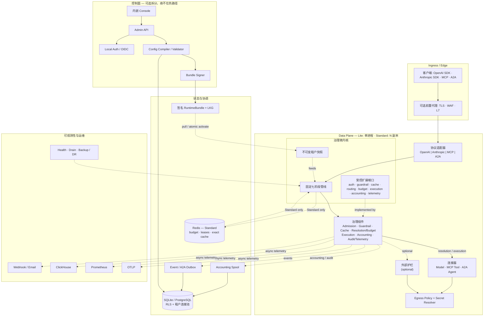

# LiteAIG

**企业级 AI Governance 与 Agentic Traffic Control Plane**

[English](README.md) | 简体中文

LiteAIG 是一个模块化单体、单二进制优先的 AI 网关与治理控制平面。它把
**Model、Tool、Agent、Human Approval** 四类交互统一收敛到一条**固定七阶段治理管线**，
使身份、授权、成本、数据边界、可靠性、安全与审计语义对所有流量一致生效。

本 README 以 **V8.5 实施基线**与当前代码实际状态为准，而不是完整的目标功能清单。
完整设计见 [LiteAIG_AI_Gateway_V8.5.md](docs/LiteAIG_AI_Gateway_V8.5.md)，
实时差距清单见 [GAP_ANALYSIS.md](docs/GAP_ANALYSIS.md)。

---

## 目录

- [产品定位](#产品定位)
- [技术架构](#技术架构)
- [功能地图](#功能地图)
- [与 LiteLLM、Higress、Kong AI Gateway 的对比](#与-litellmhigresskong-ai-gateway-的对比)
- [快速开始](#快速开始)
- [配置与运维](#配置与运维)
- [实现状态](#实现状态)
- [项目结构](#项目结构)
- [测试与质量门禁](#测试与质量门禁)
- [文档](#文档)
- [贡献](#贡献)

---

## 产品定位

### LiteAIG 是什么

LiteAIG 是 **AI 治理层**，不是另一个通用 API Gateway。它把模型供应商、Tool 与 Agent
之间的协议、身份、权限、区域、成本与运行差异收敛到一个可控边界，并提供：

- 多 Provider / 多模型接入，Logical Model 与 Deployment 解耦。
- 可解释路由、Credential Pool、Retry、Fallback 与 Circuit Breaker。
- Exact Cache 与 Semantic Cache，带租户隔离与输出重检。
- Token 计量、Provider Cost、Chargeback、Budget、Quota 与 Rate Limit。
- Guardrail 从策略编写、测试、影响预览、发布、执行、安全事件到回滚的完整生命周期。
- Request Explorer、Live Tail、Decision Timeline、Routing Simulator、Config Diff、告警与审计。
- 对 Model、MCP Tool、A2A Agent、Human Approval 的统一治理。
- Agent Identity、Delegation、Task/Session/Agent Graph、Loop Control 与 Agentic FinOps。
- External / Federated Agent Trust、双向 A2A 治理与外部采购成本。
- Draft → Validate → Diff → Publish → Activate → Rollback 的配置交付，配合签名
  RuntimeBundle 与 Last Known Good 兜底。

### LiteAIG 不做什么

LiteAIG 明确**不建设**：

- Agent Runtime、Planner、Workflow、Memory 或 Team Runtime。
- RAG Pipeline、Vector Database 或 Prompt IDE。
- 模型训练、微调或评测平台。
- 完整语音 RTC 平台。
- 通用工作流引擎或应用市场。
- 通用 Ingress Controller、Service Mesh 或 WAF。
- 任意 Wasm/JS 插件运行时，或 100+ Provider 原生适配器竞赛。

MCP 与 A2A 只作为**协议适配器与治理对象**，不是第二套 Agent 平台。LiteAIG 治理
“谁可以调用什么、在什么预算/边界/审计上下文下调用”，不负责 Agent 如何规划任务。

### 部署档位

| 档位 | 存储 / 协调 | HA 基线 | 推荐用途 | 设计目标 |
|---|---|---|---|---|
| **Lite** | SQLite + 内存缓存 | 单进程、本地 LKG、优雅关闭；不承诺基础设施 HA | 开发、小团队、边缘 | ≤200 RPS |
| **Standard** | PostgreSQL HA + Valkey/Redis HA | Gateway ≥3、Control ≥2、≥2 AZ、LKG、Accounting Spool、PDB/TopologySpread | 主流生产 | ≤5,000 RPS/副本集 |
| **Enterprise** | PostgreSQL Multi-AZ + Valkey/Redis Cluster | Gateway/Control Active-Active、≥3 AZ、Region DR、可选 Multi-Region Active | 大规模多租户/关键业务 | 水平扩展，50k+ RPS 目标 |

容量数字来自 V8.5 架构目标，不是 SLA 承诺。请用自己的拓扑、模型组合与
benchmark/DR Drill 验证。高可用属于 Core Correctness，不是单独的功能开关。

### 六项领先产品能力

| 能力 | LiteAIG 的落地 |
|---|---|
| **AI Access** | OpenAI/Anthropic 兼容接入、主流 Provider 原生适配、OpenAI-Compatible 长尾、Logical Model、Virtual Key、Model ACL、Setup Wizard、Provider Test/Model Discovery。 |
| **Explainable Smart Routing** | 先 Hard Constraints（能力、Context、ACL、Region、Residency、Health），再按 Cost/Latency/Load/Quality/Cache Affinity 评分；Route Explain Trace 与 Simulator 复用生产 Planner。 |
| **Enterprise AI FinOps** | Usage Ledger 作为唯一计量事实源；Tenant/Project/Application/Agent/Key/Org/User/Model/Provider 多维归因；Budget、Quota、Rate Limit、Cache Savings、Retry/Fallback Cost、Chargeback。 |
| **Guardrail Lifecycle** | Policy → Test Case → Impact Preview → Validate/Diff → Publish/Security Epoch → Runtime Enforcement → Security Event → Retroactive Analysis → Optimization。 |
| **AI Operations** | Playground、Request Explorer、Live Tail、Decision Timeline、Routing Simulator、Config Diff、Guardrail Impact Preview、Health/Circuit/Alert、Rollback。 |
| **Agentic Governance & Audit** | Agent Registry/Version/Endpoint/Capability、Delegation 交集、Task Budget、Loop Detection、Tool ACL、Approval Handoff、Agent Graph、Federated Trust、外部采购成本。 |

---

## 技术架构

LiteAIG 是一个**固定管线微内核**。微内核只负责 Canonical Interaction、七阶段管线、
不可变租户快照与受控扩展端口；其他部分是治理组件、适配器、连接器、状态存储或
控制面服务。**Lite 与 Standard 是部署形态，不是两套架构。**

### 架构不变量

| 不变量 | 实现 |
|---|---|
| **Modular Monolith** | 一个 `liteaig` 二进制；模块是所有权边界，不是微服务。`mode=all\|gateway\|control` 只改变运行角色。 |
| **固定管线** | 所有 Interaction 都走同一七阶段；新能力只能挂接检查点，不能重排或绕过。 |
| **Kernel 业务中立** | `internal/kernel` 只拥有 contracts、pipeline、runtime snapshot、lifecycle；不 import Provider、Policy、Storage、Control Plane 或 Wire Protocol。由 CI 强制。 |
| **WebKit 微内核** | Admin API 与 Gateway 使用 `internal/platform/webkit`（Go `http.ServeMux` + 中间件 + APIError），不引入 Echo 等第三方 Web 框架。 |
| **控制面三层** | `adminapi`（表示层）→ `controlplane/backend`（业务编排）→ `platform/storage`（持久层），依赖只能自上而下。 |
| **Compile once, sign, activate** | 配置编译为不可变租户快照，签名为 RuntimeBundle，Prepare/ACK 后原子激活；无效 Bundle 保留 Last Known Good。 |
| **控制面故障 ≠ 数据面故障** | 控制面、元数据库或 PubSub 不可用时，已加载的数据面继续使用 LKG 服务。 |
| **Durable Accounting** | Provider usage 先写本地 Accounting Spool；摄取采用 At-least-once + event_id 幂等，不宣称虚假的 Exactly Once。 |
| **Tenant 是隔离边界** | Tenant Snapshot、`TenantScope`、PostgreSQL RLS、Redis namespace、Cache namespace 与租户连接池。 |
| **显式降级** | Cache、Rate Limit、Budget、Secret、DB、PubSub、Provider 分别定义 fail-open / fail-closed / bypass / fallback。 |

### 逻辑架构



实线是同步请求/控制路径，虚线是异步或特定部署形态。该图是逻辑视图：
Lite 在同一进程中运行相同组件。

### 固定七阶段

| # | 阶段 | 职责 |
|---|---|---|
| 1 | **Admission** | Virtual Key 认证、租户快照解析、Body Limit、RPM/TPM、并发与配额。 |
| 2 | **Input Guardrail** | 本地快速规则、Size/Secret/PII/Prompt Injection、Context Guard、可选外部安全服务。 |
| 3 | **Cache** | Exact/Semantic Cache；命中短路上游执行，但仍执行输出护栏与记账。 |
| 4 | **Resolution** | Model/Tool/Agent 解析、Hard Constraints、数据地域、预算预留、Capability/ACL。 |
| 5 | **Execution & Resilience** | Provider/Tool/Agent 调用、流式处理、Retry、Fallback、Circuit、Credential Pool、可配置超时。 |
| 6 | **Output Guardrail** | 输出检查、流式 Inline/Buffered/Shadow 护栏、可选 LLM-as-Judge/Groundedness。 |
| 7 | **Accounting & Telemetry** | Token/Cost 计量、归因、审计、指标、Trace、Durable Spool 与 Outbox。 |

### 四类 Interaction

| Interaction | 示例 | 统一治理 |
|---|---|---|
| **Model** | Chat、Responses、Embeddings、Rerank、Audio、Batch、Files | Key、Quota、Budget、Guardrail、Routing、Accounting、Audit |
| **Tool** | MCP `tools/call`、`tasks/*` | Tool ACL、Schema/DLP、Approval、Tool Call Ledger |
| **Agent** | A2A 1.0 与 0.3 兼容流量 | Agent Identity、Delegation、Task/Hop Limit、Trust Boundary、Federation |
| **Human Approval** | 高风险 Tool/Agent 操作 | 短期 Grant、职责分离、Approval Audit |

四类 Interaction 都先归一化为 Canonical `InteractionContext`/`UnifiedRequest`
再进入 Kernel；协议适配器不做策略决策。

### 服务分层

| 层 | 包 | 职责 |
|---|---|---|
| 表示层 | `internal/controlplane/adminapi` | HTTP 路由、会话、CSRF、RBAC 中间件、错误渲染、SSE 帧 |
| 业务编排层 | `internal/controlplane/backend` | ControlBackend、12 个窄能力接口、类型化 View Contract |
| 持久层 | `internal/platform/storage` | `sqlrepo.Store`、SQLite/PostgreSQL 适配器、Spool |
| 组合根 | `internal/app` | 打开存储、迁移、装配 Backend 与 HTTP Server |

依赖方向由 `architecture/forbidden-imports.yaml` 与 `cmd/architecture-test` 强制。
检查器同时覆盖模块属主、表属主、migration owner、跨模块直接 SQL 与导出 API 兼容性。

### 运行时与配置交付

```text
Control Plane
  Draft -> Validate -> Diff -> Publish
    -> Compile Tenant Snapshot
    -> Sign RuntimeBundle
    -> Distribute
Data Plane
  -> Prepare (schema, signature, checksum, references)
  -> ACK / NACK
  -> Atomic Activate
  -> Keep previous + last-known-good on disk
```

NACK 不会留下半配置。控制面不可达时，Gateway 可从签名有效的 LKG 启动；但
suspended tenant 与安全 fail-closed 策略仍然优先。

### 部署剖面

| 维度 | Lite | Standard |
|---|---|---|
| 进程拓扑 | 单个 `mode=all` 进程 | `gateway` / `control` 分离副本 |
| 存储 | SQLite + Master Key Sidecar | PostgreSQL + 签名 RuntimeBundle |
| 协调 | 进程内 | PostgreSQL 租约 + Redis 账本/租约 |
| 缓存 | 进程内 Exact + 有界 Semantic | Redis Exact + 进程内 Semantic |
| 故障行为 | 重启并从本地状态恢复 | 控制面故障保留 LKG；副本故障由 HPA/PDB 处理 |
| 运维 | 极简单二进制 | HPA/PDB、Drain、多副本、外部存储 |

Enterprise 使用同一二进制，配合 Multi-AZ PostgreSQL/Redis、≥3 AZ 与 Region DR。
完整 Enterprise HA/DR 证据仍在路线图中，必须通过 Chaos/DR Drill 验证，不能仅凭
部署档位推断。

### 安全与可靠性边界

| 边界 | 控制 |
|---|---|
| **Ingress** | Virtual API Key、Body Limit、可选 TLS/WAF/L7 前置代理 |
| **Admin** | 独立监听、本地 Argon2id 或 OIDC、CSRF、RBAC |
| **Tenant** | 不可变 Tenant Snapshot、`TenantScope`、PostgreSQL RLS、租户连接池 |
| **Egress** | 统一 allowlist/SSRF 策略、Secret Resolver、外部护栏隔离 |
| **Supply Chain** | 签名 Bundle、LKG、非 root distroless 镜像、发布 SBOM |
| **Audit** | 脱敏 Domain Event、Evidence Export、Durable Spool/Outbox、OTLP 日志 |

依赖故障语义是显式的：Cache bypass；Soft Budget 可 fail-open 并告警；Hard Budget/
强制安全策略 fail-closed；Provider 故障走 Circuit/Fallback；Accounting 幂等重放。

---

## 功能地图

### AI Access

- OpenAI Chat Completions、Responses、Embeddings、Rerank、Audio
  transcription/translation/speech、Files、Batch。
- Anthropic Messages。
- OpenAI-Compatible 长尾；OpenAI、Anthropic、Azure、Bedrock、Vertex、Gemini
  原生连接器。
- Logical Model 将应用与 Deployment/Provider 解耦。
- Virtual Key、Tenant/Project Scope、Model ACL、Provider Test、Model Discovery、
  Setup Wizard。
- 官方 Go、JavaScript/TypeScript、Python SDK；现有 OpenAI SDK 只需修改 Base URL
  与 Key。

### Explainable Smart Routing

- Hard Constraints：Capability、Context Length、ACL、Region、Residency、Health。
- Soft Score：Cost、Latency、Load、Quality、Cache Affinity。
- Priority、Weighted、RoundRobin 与运行时感知路由。
- Retry、Fallback、Circuit Breaker、Credential Pool、可配置超时。
- Route Explain Trace；Simulator 与生产 Planner 使用同一实现。

### Enterprise AI FinOps

- Usage Ledger 支持 Tenant/Project/Key/Application/Agent/Org/User/Model/Provider
  多维归因。
- 多窗口 Budget、Reservation、Quota、RPM/TPM 与并发租约。
- Provider Cost、Reference Price、Chargeback、Cache Savings、Retry/Fallback Cost、
  Unpriced Token 报告。
- 语义缓存 embedding 与 Judge 等辅助调用进入预算，并带 `parent_request_id`。
- Attribution Trust 区分 verified、key-bound 与 untrusted 身份。

### Guardrail Lifecycle

- Input、Context、Output、Stream、Tool/MCP、Agent 护栏。
- Keyword/Regex/Secret/PII/Prompt Injection；可选外部护栏 Provider，支持
  `fail_open`、`fail_closed`、`bypass`。
- 流式护栏采用 Inline/Buffered/Shadow 三层；Shadow 发现是事后语义，绝不宣称能撤回
  已发送内容。
- Guardrail Test Case、Impact Preview、Security Epoch、Fast Publish、Security Event
  与 Retroactive Analysis。
- Cache 命中仍执行当前 Output Guardrail。

### AI Operations

- 内嵌响应式 Console/PWA：Setup、Dashboard、Provider/Model、Key、Project、Routing、Guardrail、
  Cache、FinOps、Alert、Audit、Agent、Tool、Approval、Federation。
- Playground、Request Explorer、Live Tail、Decision Timeline、Routing Simulator、
  Config Diff、Guardrail Impact Preview、Health/Circuit、Rollback。
- Prometheus `/metrics`、OTLP traces/metrics/logs、ClickHouse Analytics Sink、
  Webhook/Email 告警、Evidence Export。
- 优雅 Drain、Readiness 分离、备份恢复脚本、DR Drill CLI、Helm HPA/PDB/TopologySpread。

### Agentic Governance & Audit

- MCP `2026-07-28` stateless Streamable HTTP；A2A `1.0.0`，兼容 0.3 wire。
- Agent Registry、Version、Endpoint、Capability、Agent Card、Trust Anchor。
- Delegation 采用交集语义；Handoff 不允许权限放大。
- Task/Root Task/Session/Parent Request 关联；Hop/Model Call/Tool Call/Token/Cost/
  Duration 限制；Loop Detection。
- Tool ACL、Schema/DLP、Content Provenance、Tool Call Ledger、高风险 Approval Handoff。
- Inbound/Outbound Federated Trust、Capability/Project Grant、Data Boundary、外部采购
  预算、Suspend/Revoke、Security Epoch。
- Agent/Task Graph 从 Request/Agent Call/Tool Call Ledger 派生。

### Build / Integrate / Do Not Build

| 决策 | 范围 |
|---|---|
| **Build** | Tenant/Project/Identity Scope、Logical Model/Deployment/Credential Pool、RuntimeSnapshot/Config Lifecycle、Explainable Routing、Resilience、Usage Ledger/Budget/FinOps、Guardrail Lifecycle、AI Operations、Agentic Governance/Audit、Federation Trust。 |
| **Integrate** | 长尾 Provider 通过 OpenAI-Compatible 或 LiteLLM Bridge；Ingress/WAF 通过 Higress/Envoy/Nginx；Prometheus/OTel/ClickHouse/Loki；OIDC/SAML/SCIM；KMS/Vault；Webhook/Email/Slack/Teams/PagerDuty；Vector Store；A2A/MCP Adapter；Agent Runtime 通过协议接入。 |
| **Do not build** | 100+ Provider 原生适配器竞赛、通用 API Gateway/Ingress/Mesh/WAF、任意 Wasm/JS Plugin Runtime、RAG/Vector DB、Agent Runtime/Planner/Workflow、Prompt IDE、训练/微调平台、ERP/税务 Billing、IdP、MCP Tool Runtime、Multi-Agent Planner/Team Runtime。 |

---

## 与 LiteLLM、Higress、Kong AI Gateway 的对比

> 下表用于产品定位参考，不是性能基准。各项目迭代很快，请以官方文档为准。

| 维度 | **LiteAIG** | **LiteLLM** | **Higress** | **Kong AI Gateway** |
|---|---|---|---|---|
| 核心定位 | AI 治理与 Agentic Traffic Control Plane | LLM Proxy/SDK + MCP/Agent Gateway | 云原生 API Gateway + AI/MCP/Agent 插件 | 企业级 AI Gateway + AI 实体与策略 |
| 运行时 | Go，单静态二进制 | Python 服务/SDK | Envoy/Istio，Kubernetes 原生或独立 Docker | Nginx/OpenResty，Kong Gateway CP/DP |
| 配置模型 | 编译期校验快照 + 签名 Bundle | YAML + Python callback/hook | Kubernetes CRD/Gateway API + Wasm | Kong Entity + AI Policy/Plugin，decK/kongctl/Terraform |
| 扩展机制 | 固定管线 + 受控检查点；编译期注册与受控外部护栏 Hook | Python 生态与 callback | Wasm 插件生态、CRD | 大型插件生态；Lua/Go/Python/JS |
| Provider 覆盖 | OpenAI、Anthropic、Azure、Bedrock、Vertex、Gemini、Compatible | 非常广泛的多 Provider 目录 | 通过 AI 插件支持广泛 Provider | 通过 AI 插件支持广泛 Provider |
| 治理模型 | 固定七阶段、预算、TPM/RPM、RLS、审计、证据 | Virtual Key、预算、限流、路由、缓存、护栏、异步 Spend Logging | L7/WAF、AI Token 限制、缓存、内容安全、配额 | AI 限流、Prompt/Semantic Guard、PII、Semantic Cache、成本管理 |
| Agentic / MCP | A2A 1.0/0.3 + MCP 2026-07-28，同一治理路径，审批、联邦/信任 | MCP Gateway + Agent Gateway（A2A）；Router 中心 | MCP Server + AI Agent；插件中心 | AI MCP Server + A2A 流量 + AI Policy |
| 部署 | Binary、Docker、Helm；SQLite 或 PostgreSQL + Redis | Python 服务 + DB/Redis | Kubernetes 或 Docker | Konnect 或自托管 Kong CP/DP |
| 最适合 | 强治理、A2A/MCP 控制、FinOps、轻量运维 | 在 Python 生态中快速接入大量 Provider | 已使用 Envoy/Istio、需要 L7 + AI 的平台团队 | 已标准化在 Kong 上的企业 |

**取舍一览**

- **LiteAIG**：Provider 目录与插件生态小于成熟网关，且不是通用 L7/WAF 网关；
  当治理语义与轻量运维优先时最合适。
- **LiteLLM**：Provider 目录与 Python 生态非常成熟；治理模型更偏 Proxy/Router 中心，
  而不是固定治理管线。
- **Higress**：Kubernetes/Envoy 集成与 Wasm 插件覆盖出色；需要云原生数据面与 K8s
  运维模型。
- **Kong AI Gateway**：成熟的企业网关、AI 实体与大型插件生态；需要 Kong 平台、CP/DP
  运维，并考虑许可成本。

**选择 LiteAIG 的典型场景**：治理、成本归因、审计、A2A/MCP 信任与较小运维足迹，
比“最大 Provider 目录”或“通用 L7 插件生态”更重要。

**LiteAIG 不替代通用 API Gateway。** 当 Kong、Higress、Envoy、Nginx 或云负载均衡
负责 TLS/WAF/Ingress 时，LiteAIG 部署在其后方。LiteAIG 也可以通过 LiteLLM 的 OpenAI-Compatible 端点
接入长尾 Provider，但 LiteAIG 始终是最终治理与计量入口。

---

## 快速开始

### 前置条件

- Go 1.25+
- Node.js 22+：Console 资源会嵌入 Go 二进制且不纳入 Git 跟踪，全新源码检出必须先
  构建 Console；Docker 构建会自动完成。
- Docker 与 Helm 可选。

### 从源码运行（Lite）

```bash
git clone https://github.com/F31/liteAIG.git
cd liteAIG

# 全新检出先构建一次内嵌 Console 资源
(cd web/console && npm ci && npm run build)

go build -o liteaig ./cmd/liteaig

export LITEAIG_MASTER_KEY="$(openssl rand -base64 32)"
./liteaig \
  --db file:./liteaig.db \
  --admin-addr 127.0.0.1:8081 \
  --gateway-addr 127.0.0.1:8082
```

打开 `http://127.0.0.1:8081`，完成 Setup Wizard。向导会创建首个 Tenant、Provider、
Logical Model 与 Virtual Key。

```bash
export LITEAIG_KEY="<setup 生成的 virtual key>"

curl -s http://127.0.0.1:8082/v1/chat/completions \
  -H "Authorization: Bearer $LITEAIG_KEY" \
  -H "Content-Type: application/json" \
  -d '{
    "model": "default-chat",
    "messages": [{"role": "user", "content": "Hello from LiteAIG"}]
  }'
```

流式调用：

```bash
curl -N http://127.0.0.1:8082/v1/chat/completions \
  -H "Authorization: Bearer $LITEAIG_KEY" \
  -H "Content-Type: application/json" \
  -d '{
    "model": "default-chat",
    "stream": true,
    "messages": [{"role": "user", "content": "从一数到五"}]
  }'
```

### Docker

```bash
docker build -t liteaig .

docker run --rm \
  -p 8081:8081 -p 8082:8082 \
  -v liteaig-data:/data \
  -e LITEAIG_MASTER_KEY="$(openssl rand -base64 32)" \
  liteaig \
  --db file:/data/liteaig.db \
  --admin-addr 0.0.0.0:8081 \
  --gateway-addr 0.0.0.0:8082
```

镜像以 distroless 非 root（`65532`）运行。生产环境请在反向代理或 Ingress 终止 TLS，
并限制 Admin API 仅可信网络可达。

### Kubernetes / Standard

Helm Chart 支持 `gateway`/`control` 分离、HPA、PDB、滚动升级、TopologySpread 与
Drain。Standard 档需要 PostgreSQL 与 Redis。

```bash
helm install liteaig ./deploy/helm/liteaig \
  -f ./deploy/helm/liteaig/examples/split-plane-values.yaml
```

安装前创建其引用的 Secret（`liteaig-standard`），包含 `database_dsn`、
`coordinator_url`、`liteaig_master_key`、`bundle_token`、`bundle_signing_key`、
`bundle_public_key`。详见 Chart 注释与 [部署文档](docs/DEPLOYMENT.md)。

### 关键配置

| Flag / Env | 作用 |
|---|---|
| `--db` | SQLite DSN（Lite）或 PostgreSQL DSN（Standard） |
| `--mode=all\|gateway\|control` | 单进程或分离平面 |
| `--coordinator` | Standard 档 Redis 账本/租约地址 |
| `--postgres-rls` | 启用 PostgreSQL RLS 与租户连接池（默认 true） |
| `--postgres-tenant-pools` | 懒加载租户池上限（默认 16，每池 2 连接） |
| `--gateway-rpm`、`--gateway-tpm` | RPM/TPM 限制 |
| `--gateway-max-body-bytes` | 音频/视觉/文件场景调大 |
| `--stream-total-timeout` | `0` 表示流式不设总时长 |
| `--stream-idle-timeout`、`--first-token-timeout`、`--provider-timeout` | AI 流量超时调优 |
| `--external-guardrail-url` | Layer 3 外部内容安全服务 |
| `LITEAIG_MASTER_KEY` | Secret 加密主密钥（PostgreSQL 必填） |
| `--otlp-*` | OTLP Traces/Metrics/Logs 导出 |

---

## 配置与运维

- **健康检查**：`--ready-addr` 提供 `/healthz`（进程）与 `/readyz`（接受流量、
  未 Drain、Runtime 已加载）。
- **指标**：Admin Origin 提供 `/metrics`；OTLP 与 ClickHouse Sink 可选，绝不作为
  数据面 Ready 的强依赖。
- **RLS**：PostgreSQL 默认启用 RLS。租户数据面与 Admin 请求使用 `liteaig_app`
  连接池并设置 `app.tenant_id`；控制面/后台任务使用可信平台连接。
  `--postgres-rls=false` 仅用于受控回滚。
- **连接预算**：平台池最多 32 条连接；每个租户池最多 2 条；
  `--postgres-tenant-pools`（默认 16）限制租户池数量。请按 `max_connections` 规划。
- **Drain**：SIGTERM 后 readiness 先失败，停止新流量，等待普通请求与长流在
  Drain 窗口内完成，最后 finalize accounting 再退出。
- **Secret**：Provider Secret 加密落库；PostgreSQL 必须提供 Master Key。
  KMS/Vault 属于 Integrate 项，不进入同步热路径。

---

## 实现状态

下表反映当前代码状态，而不是完整 V8.5 目标。

| 状态 | 内容 |
|---|---|
| **已实现并有测试** | Modular Monolith、WebKit 微内核、控制面三层、固定七阶段、四类 Interaction、Virtual Key/HMAC、RuntimeBundle/LKG/原子激活、Accounting Spool、PostgreSQL RLS 与租户连接池、Lite/Standard、内嵌 Console、Exact/Semantic Cache、Guardrail Lifecycle、外部护栏 fail mode、FinOps/Budget、A2A 1.0/0.3 + MCP 2026-07-28、Approval、Federation Trust、Observability、架构 CI、Gateway Load Smoke。 |
| **部分实现** | Enterprise Multi-AZ/Region DR 自动化、分布式 Semantic Cache 后端、SCIM（仅 Contract）、MCP Task Store/Subscription、OrgUnit/User Budget 执行。 |
| **尚未实现** | SAML、gRPC Extension Bridge、Slack/Teams/PagerDuty、FX/价格源、Admin API OpenAPI Baseline、Terraform Provider。 |
| **延期 / 不建设** | 完整多租户 SaaS 包装、Multi-Region Active/Active、任意 Plugin Runtime、Agent Runtime/Planner/Workflow/Memory、RAG/Vector DB、通用 Ingress/WAF/Service Mesh、训练/微调平台。 |

实时功能差距与交付阶段见 [GAP_ANALYSIS.md](docs/GAP_ANALYSIS.md) 与
[ROADMAP_V86_COMPLIANCE.md](docs/ROADMAP_V86_COMPLIANCE.md)。

---

## 项目结构

```text
cmd/liteaig/                 单二进制入口
cmd/architecture-test/       import/module/table/SQL 边界检查
architecture/                modules、forbidden imports、table owners
internal/kernel/             Interaction、Pipeline、Runtime Snapshot、Contracts
internal/access/protocol/    OpenAI / Anthropic / MCP / A2A 适配
internal/gateway/            Admission、Guardrail、Cache、Routing、Execution
internal/connectors/         Model、Tool、Agent 连接器
internal/controlplane/       adminapi、backend、config、setup、RBAC、approval
internal/finops/             Accounting、Budget、Pricing、Aggregation
internal/federation/         Trust Relationship、Anchor、Grant
internal/platform/           WebKit、Storage、Coordination、Secrets、Egress、Bundle、LKG
web/console/                 React + TypeScript + Vite Console
deploy/helm/liteaig/         Kubernetes Chart
migrations/                  SQLite/PostgreSQL Schema
```

---

## 测试与质量门禁

```bash
make test      # go test -race ./...
make check     # go vet + 架构边界 + Console 检查
go build ./...
```

主要门禁：

- 架构边界测试（`cmd/architecture-test`）：模块属主、禁则 import、表属主、
  migration owner、跨模块直接 SQL。
- Gateway Load Smoke（`internal/app/gateway_load_smoke_test.go`）。
- PostgreSQL RLS 集成与端到端测试。
- 官方 SDK Conformance 与 OpenAPI 兼容性检查。
- Kubernetes kind Standard 拓扑 Smoke（PostgreSQL + Redis + 多副本）。
- CI 中的 `govulncheck`、npm audit、Helm/Kubernetes manifest 校验。

PostgreSQL 测试通过 `LITEAIG_TEST_POSTGRES_DSN` 启用；Redis 测试使用仓库的
coordination 测试环境。

---

## 文档

- [V8.5 实施基线](docs/LiteAIG_AI_Gateway_V8.5.md)
- [白皮书：产品与架构](docs/WHITEPAPER.md)
- [部署指南](docs/DEPLOYMENT.md)
- [差距分析与路线图](docs/GAP_ANALYSIS.md)
- [DR Runbook](docs/DR_RUNBOOK.md)
- [API 兼容性](docs/API_COMPATIBILITY.md)
- [SDK 兼容性](docs/SDK_COMPATIBILITY.md)
- [A2A Conformance](docs/A2A_CONFORMANCE.md)
- [网关性能基准](docs/GATEWAY_BENCHMARK.md)

---

## 贡献

欢迎提交 Issue 与 Pull Request。提交前请运行：

```bash
make test
make check
```

请保持以下不变量：固定管线、不允许任意 Stage 绕过、租户级数据访问必须携带
`TenantScope`、运行配置必须签名并可回滚、架构边界由 CI 强制。
